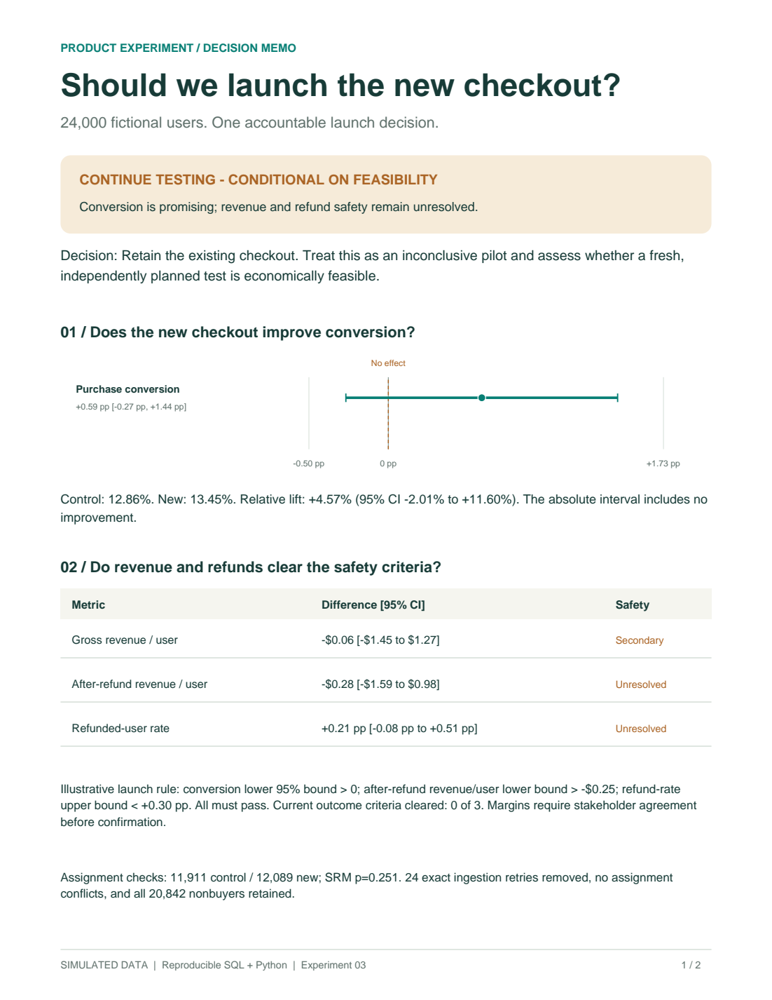

# Should we launch the new checkout?

**Product analytics portfolio · SQL + Python · Randomized experiment · Clearly labeled simulation**

[](https://github.com/MaxListon/checkout-experiment-analysis/actions/workflows/tests.yml)

A simpler checkout converts more users in the point estimate, but that's not enough on its own — the experiment doesn't establish a reliable lift, and it doesn't rule out a revenue or refund problem. **Recommendation: retain the current checkout; continue testing only if confirmation is economically feasible.**

[Live visual case study](https://maxliston.github.io/checkout-experiment-analysis/) · [Read the two-page decision brief](experiment-readout.pdf) · [Open the executed notebook](analysis.ipynb)



## The decision in 30 seconds

| Outcome | New minus control | 95% confidence interval |
|---|---:|---:|
| Purchase conversion | +0.59 percentage points | −0.27 to +1.44 pp |
| Gross revenue / assigned user | −$0.06 | −$1.45 to +$1.27 |
| Revenue after observed refunds / user | −$0.28 | −$1.59 to +$0.98 |
| Refunded-user rate | +0.21 percentage points | −0.08 to +0.51 pp |

24,000 assigned users. 11,911 control / 12,089 treatment. Sample-ratio mismatch p = 0.251. All 20,842 nonbuyers remain in the denominator.

**The insight that changes the next step:** conversion alone needs roughly 50,000 users per arm, but demonstrating revenue safety within an illustrative $0.25 loss limit needs approximately **645,000 per arm** — even if the true revenue loss is zero. So a longer conversion test by itself doesn't settle the business decision. These are rough marginal-power scenarios, not a number you'd actually launch on. The 1- vs. 3-day window comparison is exploratory and has no confidence interval or test behind it, so don't use it to cherry-pick whichever window looks best.

## What makes this project useful to review

- **Decision ownership:** calculate launch, continue or redesign classifications from confidence bounds and explicit safety margins. Assess whether more evidence is worth its cost.
- **Correct SQL grain:** one row per assigned user; exact duplicate retries removed; nonbuyers retained; purchases and refunds have defined windows.
- **Join discipline:** aggregate refunds by order before orders by user, preventing revenue multiplication from split refunds.
- **Statistical reasoning:** absolute and relative conversion effects; Wilson/Newcombe intervals; 10,000 user-level bootstrap resamples for revenue; explicit sample-ratio check.
- **Business explanation:** decompose the revenue difference into conversion, orders per buyer, average order value and refunds — descriptive, not causal.
- **Reproducibility:** fixed seeds, configuration file, enforced data contracts, 22 behavioral tests, an executed notebook and independent SQL/Python reconciliation.

## Reproduce everything

Python **3.11+**. Tested on Python 3.12.14 and 3.14.10. SQLite is included with Python. Dependencies are pinned in `requirements.txt`; no external data download is required.

```sh
python3 -m venv .venv
.venv/bin/python -m pip install -r requirements.txt
.venv/bin/python src/rebuild.py --regenerate
```

On Windows, use `.venv\Scripts\python` instead of `.venv/bin/python`.

The rebuild command regenerates the simulation when requested, then analyzes the data, builds all reports, executes the notebook cells, runs the tests, and verifies the package — exporting a ZIP beside the project folder. Omit `--regenerate` to analyze the existing source CSVs instead; the raw CSVs only change when you pass that flag, though generated outputs get replaced either way. The configured treatment allocation drives both the simulated assignment and the sample-ratio check.

For individual steps:

```sh
python src/run_analysis.py                 # source CSVs → SQLite + estimates + QA
python src/build_readout.py                # estimates → HTML + PDF + SVG charts
python src/build_notebook.py               # execute cells and save notebook outputs
python -m unittest discover -s tests -v    # measurement / inference / decision tests
python src/verify_project.py               # links, hashes, notebook, PDF and reconciliation
```

The notebook is normal Python cells, executed in order in a shared namespace by `build_notebook.py`, which saves the real outputs rather than faking them. Jupyter can open and rerun it, but isn't needed for the command-line rebuild.

## Browse the project

| File or folder | What to review |
|---|---|
| [experiment-readout.pdf](experiment-readout.pdf) | Two-page recruiter/stakeholder brief |
| [readout.html](readout.html) | Offline case study, six charts, assumptions and decisions |
| [analysis.ipynb](analysis.ipynb) | Executed analytical walkthrough |
| [config.json](config.json) | Seeds, assignment probability, windows, extract date and illustrative decision margins |
| [sql/00_schema.sql](sql/00_schema.sql) | Source keys, constraints and indexes |
| [sql/01_user_analysis.sql](sql/01_user_analysis.sql) | Quality gates and assigned-user analysis table |
| [src/statistics_tools.py](src/statistics_tools.py) | Statistical methods and dynamic decision rule |
| [src/quality.py](src/quality.py) | Source contracts and independent reconciliation |
| [tests/test_analysis.py](tests/test_analysis.py) | Edge cases and statistical behavior |
| [docs/METHODOLOGY.md](docs/METHODOLOGY.md) | Estimands, formulas, sample planning and limitations |
| [docs/CHANGELOG.md](docs/CHANGELOG.md) | Improvements and validation evidence |

`data/` contains five source CSVs, an analytical CSV and a ready-to-query SQLite database. `results/` includes unrounded metrics, bootstrap draws, sensitivity tables, quality reports and data hashes. `charts/` contains six standalone SVGs and the PDF preview.

For SQL-only exploration, open `data/experiment.sqlite`, run `sql/01_user_analysis.sql` as a complete script, then `sql/02_quality_and_metrics.sql`. The schema and normalized timestamps are already loaded. SQL itself blocks assignment conflicts, missing assigned-user records and immature follow-up; the Python loader adds full timestamp, ledger and key validation.

## Scope and provenance

All data are fictional. Seed 314159 and the original 24,000-user pilot are preserved, with no seed search or outcome tuning behind them. The default treatment allocation is 50:50, read from configuration by both the generator and the allocation check. Version 2 preserves all six CSV hashes from version 1, including the analysis table. The simulated treatment effect is disclosed in the [data dictionary](docs/DATA_DICTIONARY.md) rather than treated as business evidence.

This is a portfolio simulation, not work done for a real retailer, and the safety margins are illustrative assumptions rather than approved policy or a historical preregistration. Revenue after observed refunds isn't profit, either. Traffic availability, implementation cost and long-term customer value are all unknown, so I'm not claiming more testing has positive expected value — that would need numbers this project doesn't have.

The PDF was rendered and checked by eye. The HTML's source, links and charts were checked programmatically, but the rendered page itself hasn't been opened and eyeballed in a browser, so treat that specific piece as unverified.
