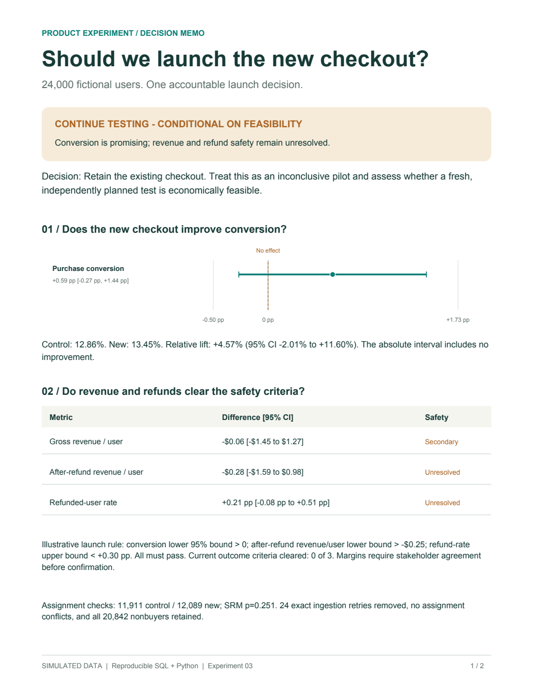

# Should we launch the new checkout?

**Product analytics portfolio · SQL + Python · Randomized experiment · Clearly labeled simulation**

A simpler checkout converts more users in the point estimate, but the experiment does not establish a reliable lift or revenue/refund safety. **Recommendation: retain the current checkout; continue testing only if confirmation is economically feasible.**

[Read the two-page decision brief](experiment-readout.pdf) · [Explore the visual case study](readout.html) · [Open the executed notebook](analysis.ipynb)



## The decision in 30 seconds

| Outcome | New minus control | 95% confidence interval |
|---|---:|---:|
| Purchase conversion | +0.59 percentage points | −0.27 to +1.44 pp |
| Gross revenue / assigned user | −$0.06 | −$1.45 to +$1.27 |
| Revenue after observed refunds / user | −$0.28 | −$1.59 to +$0.98 |
| Refunded-user rate | +0.21 percentage points | −0.08 to +0.51 pp |

24,000 assigned users. 11,911 control / 12,089 treatment. Sample-ratio mismatch p = 0.251. All 20,842 nonbuyers remain in the denominator.

**The insight that changes the next step:** conversion alone needs roughly 50,000 users per arm, but demonstrating revenue safety within an illustrative $0.25 loss limit needs approximately **645,000 per arm**, even under zero true revenue loss. A longer conversion test alone does not resolve the business decision. These are approximate marginal-power scenarios, not a guaranteed launch sample size. The 1- and 3-day window comparison is exploratory: it includes no confidence intervals or tests and must not be used to choose whichever window looks best.

## What makes this project useful to review

- **Decision ownership:** calculate launch, continue or redesign classifications from confidence bounds and explicit safety margins. Assess whether more evidence is worth its cost.
- **Correct SQL grain:** one row per assigned user; exact duplicate retries removed; nonbuyers retained; purchases and refunds have defined windows.
- **Join discipline:** aggregate refunds by order before orders by user, preventing revenue multiplication from split refunds.
- **Statistical reasoning:** absolute and relative conversion effects; Wilson/Newcombe intervals; 10,000 user-level bootstrap resamples for revenue; explicit sample-ratio check.
- **Business explanation:** decompose the revenue difference into conversion, orders per buyer, average order value and refunds. Label the decomposition descriptive.
- **Reproducibility:** fixed seeds, configuration file, enforced data contracts, 22 behavioral tests, an executed notebook and independent SQL/Python reconciliation.

## Reproduce everything

Python **3.11+**. Tested on Python 3.12.14. SQLite is included with Python. Dependencies are pinned in `requirements.txt`; no external data download is required.

```sh
python3 -m venv .venv
.venv/bin/python -m pip install -r requirements.txt
.venv/bin/python src/rebuild.py --regenerate
```

On Windows, use `.venv\Scripts\python` instead of `.venv/bin/python`.

The rebuild command regenerates the simulation when requested, analyzes the data, builds all reports, executes the notebook cells, runs the tests and verifies the package. It exports a ZIP beside the project folder. Omit `--regenerate` to analyze the existing source CSVs. Existing generated outputs are replaced; raw CSVs are changed only with `--regenerate`. The configured treatment allocation controls both simulated assignment and the sample-ratio check.

For individual steps:

```sh
python src/run_analysis.py                 # source CSVs → SQLite + estimates + QA
python src/build_readout.py                # estimates → HTML + PDF + SVG charts
python src/build_notebook.py               # execute cells and save notebook outputs
python -m unittest discover -s tests -v    # measurement / inference / decision tests
python src/verify_project.py               # links, hashes, notebook, PDF and reconciliation
```

The notebook uses normal Python cells. `build_notebook.py` actually executes them in order in a shared Python namespace and saves the outputs; it does not invent outputs or merely mark cells executed. Jupyter can open and rerun it, but is not needed for the command-line rebuild.

## Browse the project

| File or folder | What to review |
|---|---|
| [experiment-readout.pdf](experiment-readout.pdf) | Two-page recruiter/stakeholder brief |
| [readout.html](readout.html) | Offline case study, six charts, assumptions and decisions |
| [analysis.ipynb](analysis.ipynb) | Executed analytical walkthrough |
| [config.json](config.json) | Seeds, assignment probability, windows, extract date and illustrative decision margins |
| [sql/00_schema.sql](sql/00_schema.sql) | Source keys, constraints and indexes |
| [sql/01_user_analysis.sql](sql/01_user_analysis.sql) | Quality gates and assigned-user analysis table |
| [src/statistics_tools.py](src/statistics_tools.py) | Statistical methods and dynamic decision rule |
| [src/quality.py](src/quality.py) | Source contracts and independent reconciliation |
| [tests/test_analysis.py](tests/test_analysis.py) | Edge cases and statistical behavior |
| [docs/METHODOLOGY.md](docs/METHODOLOGY.md) | Estimands, formulas, sample planning and limitations |
| [docs/INTERVIEW_GUIDE.md](docs/INTERVIEW_GUIDE.md) | Interview narrative, questions and honest resume wording |
| [docs/CHANGELOG.md](docs/CHANGELOG.md) | Improvements and validation evidence |
| [GITHUB_GUIDE.md](GITHUB_GUIDE.md) | GitHub setup, resume bullets and sharing checklist |

`data/` contains five source CSVs, an analytical CSV and a ready-to-query SQLite database. `results/` includes unrounded metrics, bootstrap draws, sensitivity tables, quality reports and data hashes. `charts/` contains six standalone SVGs and the PDF preview.

For SQL-only exploration, open `data/experiment.sqlite`, run `sql/01_user_analysis.sql` as a complete script, then `sql/02_quality_and_metrics.sql`. The schema and normalized timestamps are already loaded. SQL itself blocks assignment conflicts, missing assigned-user records and immature follow-up; the Python loader adds full timestamp, ledger and key validation.

## Scope and provenance

All data are fictional. Seed 314159 and the original 24,000-user pilot are preserved; no seed search or outcome tuning was used. The default treatment allocation is 50:50 and is read from configuration by both the generator and allocation check. Version 2 preserves all six CSV hashes from version 1, including the analysis table. The simulated treatment effect is disclosed in the [data dictionary](docs/DATA_DICTIONARY.md); it is not treated as business evidence.

The design is a portfolio simulation, not work conducted for a real retailer. Safety margins are illustrative assumptions, not approved policy or historical preregistration. Revenue after observed refunds is not profit. Available traffic, implementation cost and long-term customer value are unknown, so the project does not claim that more testing has positive expected value.

The PDF was rendered and visually reviewed. HTML source, links and shared charts were checked; local HTML browser preview remains unavailable under the environment's browser policy.
